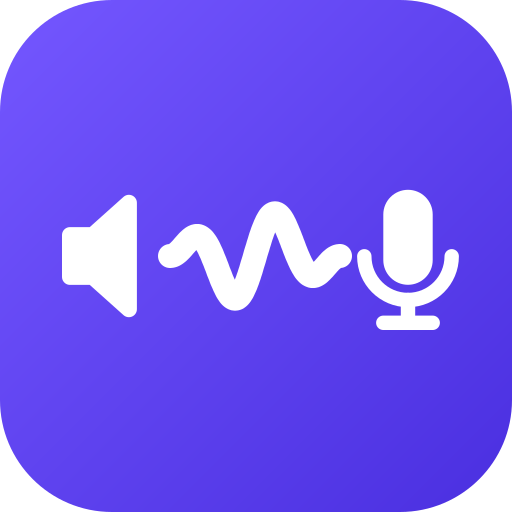
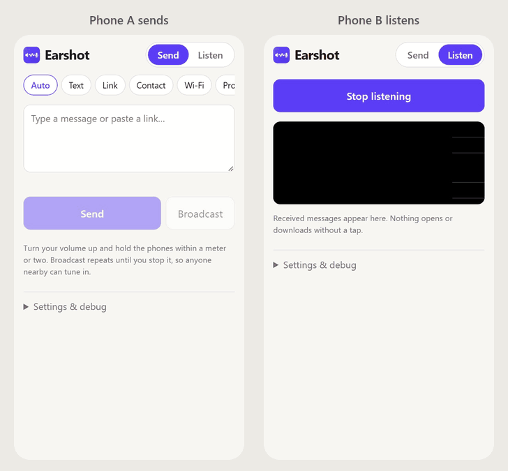

# Earshot

**Send a message to every phone within earshot, using sound. No app, no install, no server.**

Try it: **https://thomas-villani.github.io/earshot/**

Open the page on two devices, type something on one, press **Send**, and press **Start listening** on the other. The message travels through the air as a short burst of tones and shows up as a card on the receiving screen.



<sub>A real decode, recorded in headless Edge: the receiver hears the actual transmission through a simulated microphone (see [NOTES.md](NOTES.md)).</sub>

**Install it (optional).** Earshot is a Progressive Web App (PWA). In Chrome on Android, use the menu → *Install app* (or *Add to Home screen*) to get an icon that opens full screen. After your first visit it works offline, including in airplane mode, since sound needs no network.

## What you can send

| Type | What the receiver gets |
|---|---|
| Text | The message, with Copy and Share buttons |
| Link | The full URL with an **Open** button (never opened automatically; http and https only) |
| Contact | Name, phone, email, organization, with "Add to contacts" (a `.vcf` file), Share and Copy |
| Wi-Fi | Network name and security type; the password stays hidden until you tap **Show**, with Copy buttons |
| AI prompt | A prompt (plus optional context) with "Send to assistant…", which opens the system share sheet so you can pick an assistant app |

The **Auto** type detects links and `WIFI:` QR-style strings in whatever you type or paste. On Android Chrome, the Contact form can also fill itself from your address book ("Pick from my contacts").

Sound is a broadcast medium, so **one sender can reach any number of listeners at once**. Press **Broadcast** instead of **Send** and the message repeats until you stop it. Anyone who starts listening partway through still gets the whole message (see [fountain coding](technical-guide.md#6-fountain-coding)).

## How to use it

**Send tab:** pick a type (or leave it on Auto), fill in the message, and check the size and estimated airtime shown under the form. Then:

- **Send** plays the message once, with a little redundancy built in.
- **Broadcast** loops until you press Stop, and keeps the screen awake while it runs.

**Listen tab:** tap **Start listening** and allow microphone access. A live spectrogram shows what the mic hears, with the audible and ultrasound bands marked. Long messages show a progress bar while blocks arrive. Finished messages appear as cards, and hearing the same message again bumps a "heard N×" counter instead of adding a duplicate.

**Settings & debug** (at the bottom of the page):

- **Transmit mode.** The speed tiers are Normal, Fast and Fastest, available in three families:

  | Mode | What it does |
  |---|---|
  | **Dual band** (default: Dual Fast) | Plays audible and ultrasound tones at the same time, carrying different data, for about twice the speed |
  | Audible | 1.9–6.4 kHz. You hear a chirpy whistle. |
  | Ultrasound | 15–19.5 kHz. Mostly inaudible to adults. |
  | Low tones (DT) | Lower dual-tone protocols. Unreliable in testing and kept only for experiments. |

  Normal is the most robust in echoey rooms, Fast is the default balance, and Fastest is marked "fragile": in the simulator it drops frames even in good conditions.

  Receivers always listen on both bands, so the listener doesn't need to pick a mode.
- **Volume** (5–100, default 25) sets the output level of the generated tones. Your device volume matters too: turn it up, and keep the devices within a meter or two.
- **Debug** shows the session ID, applied microphone settings, and a hex log of every frame sent and received.

## How long does it take?

ggwave, the modem underneath, is slow by design: about 15 bytes per second on Fast and about 28 B/s on Fastest for a full frame, plus roughly a second of fixed overhead per transmission. Some reference points (from [NOTES.md](NOTES.md)):

| Message | Approximate time |
|---|---|
| A short text, after compression (about 12 bytes on average) | about 2 s on Fast |
| A typical URL | about 3 s on Fast |
| 500 bytes, Dual Fast, simulated living room | about 16 s |
| 1,500 bytes, Dual Fast, simulated living room | about 35 s |

In a real-world test, a 500-character message took about 30 seconds on Dual Fast.

Messages are compressed with a small built-in model tuned for short text, which roughly halves the size of typical messages (details in the [technical guide](technical-guide.md#5-compression)).

## Browser and device support

What has actually been tested so far:

| Setup | Result |
|---|---|
| Laptop (Chrome) ↔ Android (Chrome), both directions | Works reliably, audible and ultrasound |
| Android ↔ Android, phone to phone | Works reliably in both directions, including ultrasound |
| iPhone / iOS Safari | **Untested so far** |

On Android Chrome, the browser honored the request for a 48 kHz audio context and for turning off echo cancellation, noise suppression and automatic gain control, all of which matter for decoding. The open items, including everything on iOS, are tracked in the manual test checklist in [NOTES.md](NOTES.md#manual-test-checklist-real-devices).

You need a modern browser with microphone access, Web Audio (AudioWorklet) and `CompressionStream`. The page must be served over HTTPS, which GitHub Pages provides.

**A note on ultrasound and pets:** "ultrasound" here means 15–19.5 kHz. Most adults can't hear it, but many animals can. Cats in particular have been seen reacting to it. Use the audible mode if there are pets around.

## Privacy and safety

- **No backend.** Earshot is a static web page. Once it has loaded, nothing you send leaves your device except as sound, and nothing you receive comes from anywhere but the microphone.
- **Nothing decoded is ever acted on automatically.** Links need a tap on Open, contacts need a tap to save, Wi-Fi passwords need a tap to reveal or copy, and prompts need a tap to share. Only http(s) links get an Open button; anything else (such as `javascript:`) is shown as plain text.
- **Broadcasts are not secret.** Anyone within earshot running Earshot, or any other ggwave decoder, can receive what you send. That includes Wi-Fi passwords: sharing one this way is like reading it aloud in the room. There is no encryption in v1.
- **Anyone nearby can also send.** Treat received messages like any other message from a stranger, and check a link before you open it.

## How it works

Your message is packed into a compact binary form and compressed with whichever of three methods gives the smallest result. A short message fits in a single *frame* of at most 140 bytes. A longer one is split into blocks and *fountain coded*: the sender produces an endless stream of combined blocks, and a listener can rebuild the message from any sufficient set of them, so missed or late frames don't matter. Each frame gets a small header with a checksum and is turned into sound by [ggwave](https://github.com/ggerganov/ggwave), a modem that encodes data as several tones at once and adds Reed–Solomon error correction. In dual-band mode, two frames, one audible and one ultrasonic, are mixed into one waveform and play together.

On the receiving side, an AudioWorklet streams microphone samples to two ggwave decoders (one per band). Frames that pass the checksum are reassembled, decompressed and shown as cards.

For the full story, from why sound is a hard channel to the byte layouts, the compression model and the simulator results, read the **[technical guide](technical-guide.md)**.

## Development

Requires Node.js (CI uses Node 24) and npm.

```sh
npm install
npm run dev        # Vite dev server over HTTPS
npm test           # Vitest unit tests
npm run sim        # acoustic channel simulator; prints success-rate tables
npm run build      # type-check and build the static site into dist/
```

- **Testing on phones.** Microphone access needs a secure context, so the dev server uses `@vitejs/plugin-basic-ssl` to serve HTTPS with a self-signed certificate. `vite.config.ts` sets `server.host: true` (the same as `--host`), so the server is reachable on your LAN. Open the printed network URL on your phone and accept the certificate warning.
- **Simulator options.** `npm run sim -- --trials 30 --only B,D` runs selected experiments (A–G) with more trials per cell. More in the [technical guide](technical-guide.md#9-the-channel-simulator).
- **Spikes.** `npm run spike` and `npm run spike:errors` reproduce the original ggwave binding and error measurements in Node.

### Retraining the compression model

The shipped model is `src/compress/model-data.json`. To retrain it, download the training data into a `data/` folder at the repo root (it is git-ignored and not redistributed):

| File | Source |
|---|---|
| `data/gpt2/vocab.bpe` | GPT-2's BPE merges file from [openai/gpt-2](https://github.com/openai/gpt-2) (the `vocab.bpe` published with the 124M model) |
| `data/tatoeba/eng_sentences.tsv` | Tatoeba's English sentence export (`eng_sentences.tsv.bz2` from the [Tatoeba downloads](https://tatoeba.org/downloads), decompressed) |
| `data/gutenberg/pg1661.txt` | *The Adventures of Sherlock Holmes*, [Project Gutenberg eBook #1661](https://www.gutenberg.org/ebooks/1661), plain text |

Then:

```sh
npm run train:compress                 # writes src/compress/model-data.json (4,096-token vocabulary)
npm run train:compress -- --sweep      # compare vocabulary sizes; doesn't write the model
npm run eval:compress                  # size and airtime on the held-out message set
```

Synthetic URLs, emails, contacts and Wi-Fi payloads are generated by the training script itself. **A retrained model must get a new codec ID** so that older copies of the page reject it instead of decoding garbage.

### Deployment

Every push to `main` triggers `.github/workflows/deploy.yml`, which runs the tests, builds the site and publishes `dist/` to GitHub Pages.

## Project layout

```
index.html              page shell (Send / Listen tabs, settings drawer)
vite.config.ts          build config, including the plugin that generates the offline service worker
public/                 web manifest and icons (logo source: public/icons/icon.svg)
docs/                   demo GIF
src/
  main.ts               app wiring: modes, send/broadcast loop, listen loop
  modem/                Modem interface + ggwave adapter (the only code that touches ggwave)
  framing/              frame header + CRCs, typed messages, send/receive pipeline
  fountain/             random linear fountain code over GF(2)
  compress/             tokenizer, arithmetic coder, trained model data
  audio/                AudioContext, mic capture (AudioWorklet), playback
  ui/                   send form, message cards, spectrogram, vCard export
test/                   Vitest suites, channel simulator (channel-sim.ts, sim/), compression eval
tools/                  train-compressor.ts
spike/                  milestone 0 and dual-band experiments
SPEC.md                 format specification and milestone plan
NOTES.md                measured numbers, device findings, manual test checklist
```

## Roadmap

v1 (acoustic messaging) is built: typed messages, framing, fountain coding, broadcast, dual band and compression. The longer-term goal is a general way to send things to nearby people with no server. Sound handles messages and lets devices find each other, and files take the fastest path that works. What's next, per [SPEC.md](SPEC.md):

- **v2: file transfer over WebRTC.** Sound is used only for the handshake. The sender chirps a compacted WebRTC offer (about 90–130 bytes), the receiver chirps back an answer, and the two browsers then open a direct peer-to-peer data channel and move files at Wi-Fi speeds. Both screens show a short verification code so you can confirm you're connected to the right device. There is still no signaling server; public STUN servers are the only network dependency.
- **v3: visual transfer.** Stream a file as animated QR codes on one screen and read it with the other phone's camera. It needs no network, so it works when the two phones aren't on the same Wi-Fi. It uses the same fountain coding as long messages, and a chirp tells the sender when the receiver is done.
- **v4 (idea): nearby multiplayer.** The v2 connection becomes a game transport: walk up, chirp, play.

What remains for v1 is finishing the real-device checklist, especially on iOS.

## Credits

- [ggwave](https://github.com/ggerganov/ggwave) by Georgi Gerganov (MIT): the acoustic modem.
- [GPT-2](https://github.com/openai/gpt-2) BPE merges (OpenAI, modified MIT): the candidate vocabulary for the compression model.
- [Tatoeba](https://tatoeba.org) (CC BY 2.0 FR): English sentences used to train token frequencies.
- [Project Gutenberg](https://www.gutenberg.org): *The Adventures of Sherlock Holmes*, also used for training.

Full notices are in [THIRD_PARTY_NOTICES.md](THIRD_PARTY_NOTICES.md).

## License

[MIT](LICENSE). Third-party components keep their own licenses; see [THIRD_PARTY_NOTICES.md](THIRD_PARTY_NOTICES.md).
